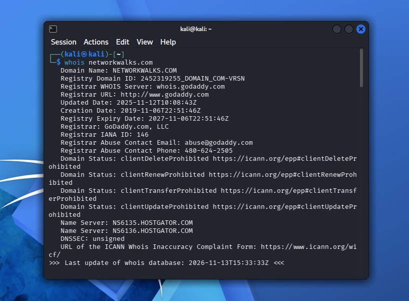
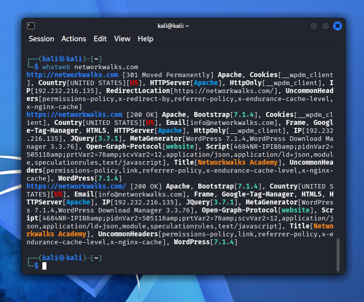
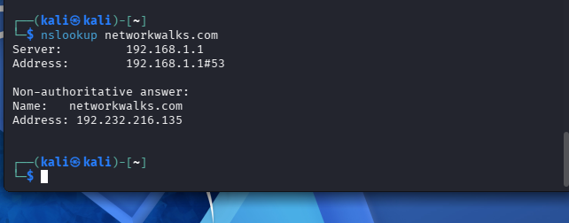
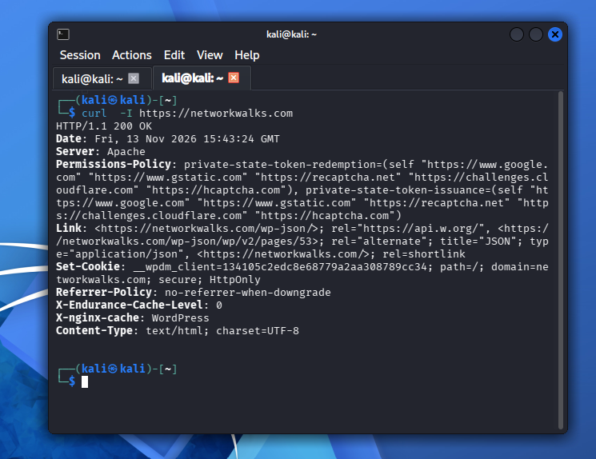
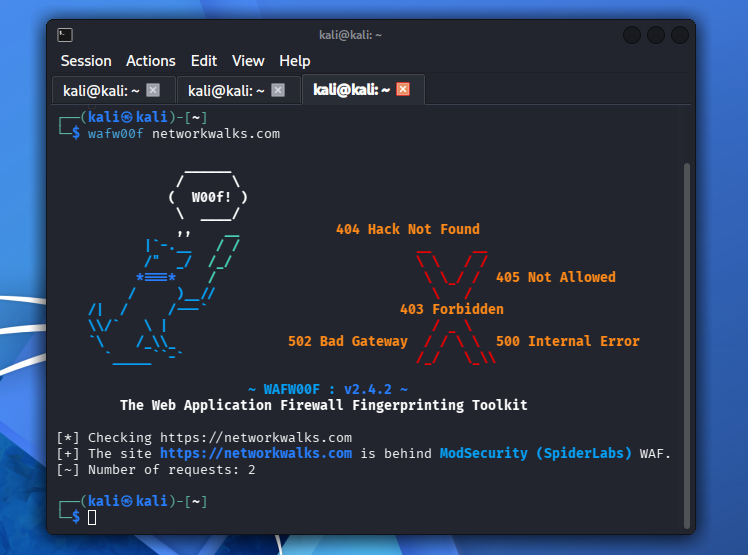
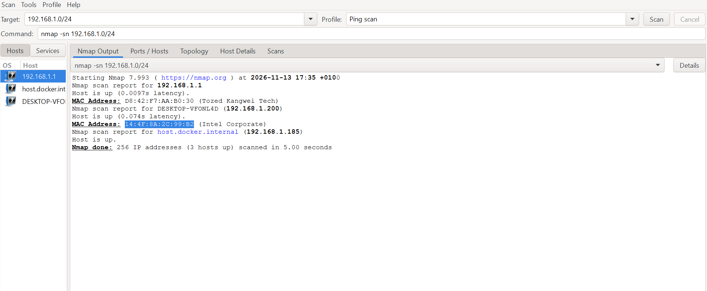
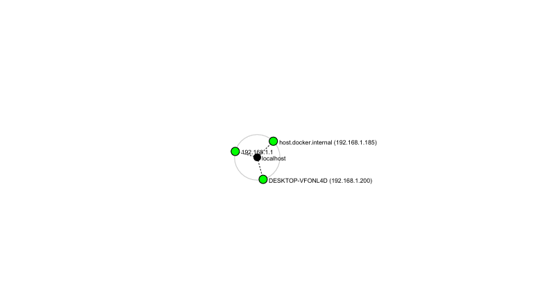

# Week 02: Footprinting, Reconnaissance & Network Scanning

## Project Overview

This project documents practical footprinting and reconnaissance of `networkwalks.com` using Kali Linux tools, together with host discovery on a local LAN using Zenmap.

The work forms part of the **Cybersecurity Professional Program at NETWORKWALKS**. It demonstrates how publicly observable domain and web-service information can be collected and how active devices on a local subnet can be identified.

## Objectives

- Retrieve public domain registration and name-server information with WHOIS.
- Identify publicly detectable website technologies with WhatWeb.
- Resolve the domain name to an IP address using Nslookup.
- Inspect HTTP response headers with Curl.
- Check for a detectable Web Application Firewall using Wafw00f.
- Scan the local subnet with Zenmap to identify live hosts.
- Record observed IP addresses and available MAC addresses.
- Capture and document evidence for each practical activity.

## Lab Environment

| Component | Configuration |
|---|---|
| Reconnaissance OS | Kali Linux |
| Network scanning tool | Zenmap / Nmap |
| Target domain | `networkwalks.com` |
| DNS resolver shown | `192.168.1.1` |
| Resolved domain IP | `192.232.216.135` |
| Local subnet scanned | `192.168.1.0/24` |
| Nmap scan profile | Ping Scan |
| Scan command | `nmap -sn 192.168.1.0/24` |
| Date | 13 November 2026 |

> **Scope note:** The supplied Networkwalks sample report records written permission for the target domain. The LAN scan was performed against the local network. Testing must remain within the authorized scope.

## Tools Used

| Tool | Purpose |
|---|---|
| WHOIS | Retrieve public domain registration, registrar, status and name-server information. |
| WhatWeb | Fingerprint web technologies, server and application components. |
| Nslookup | Resolve the domain name to an IP address using DNS. |
| Curl `-I` | Inspect HTTP response headers. |
| Wafw00f | Detect whether a Web Application Firewall is present. |
| Zenmap / Nmap | Discover live hosts on the local subnet and display available host details. |

## Activities Performed

### 1. WHOIS – Domain Registration

```bash
whois networkwalks.com
```

The output identified GoDaddy, LLC as the registrar and listed `whois.godaddy.com` as the registrar WHOIS server. It displayed a creation date of 6 November 2019, a registry expiry date of 6 November 2027, and the name servers:

- `NS6135.HOSTGATOR.COM`
- `NS6136.HOSTGATOR.COM`

The output also listed domain status restrictions, including client transfer, update, delete and renew prohibition statuses.

**Why it matters:** Domain registration and name-server information can support public infrastructure profiling. These details are informational and do not, by themselves, indicate a vulnerability.

### 2. WhatWeb – Website Fingerprinting

```bash
whatweb networkwalks.com
```

WhatWeb identified Apache and WordPress 7.1.4. It also detected Bootstrap 7.1.4, jQuery 3.7.1, WP Download Manager and other publicly detectable website technologies. The output returned the IP address `192.232.216.135`.

**Why it matters:** Technology fingerprints can help identify components that may need patch and configuration review. Detection of a product or version is not proof that it is vulnerable.

### 3. Nslookup – DNS Resolution

```bash
nslookup networkwalks.com
```

The resolver shown in the screenshot was `192.168.1.1`. The non-authoritative DNS answer resolved `networkwalks.com` to:

```text
192.232.216.135
```

**Why it matters:** DNS resolution identifies the IP address associated with the domain at the time of the query and supports infrastructure mapping.

### 4. Curl – HTTP Response Headers

```bash
curl -I https://networkwalks.com
```

The server returned `HTTP/1.1 200 OK`. The response included Apache server information, `X-Frame-Options: SAMEORIGIN`, a WordPress REST API reference at `/wp-json/`, and other application-related headers.

**Why it matters:** HTTP headers can reveal server and application characteristics. Security-related headers should be reviewed against the application's requirements.

### 5. Wafw00f – WAF Detection

```bash
wafw00f networkwalks.com
```

Wafw00f reported that the website was behind **ModSecurity (SpiderLabs)** and reported two requests during its check.

**Why it matters:** The result indicates that a WAF was detected. It does not prove that the WAF blocks every attack or that the application is fully protected.

### 6. Zenmap – Local Network Discovery

The local subnet was scanned using the Zenmap **Ping Scan** profile.

```bash
nmap -sn 192.168.1.0/24
```

The scan covered 256 IP addresses and identified **three live hosts**:

| IP Address | Host Name | MAC Address | Vendor / Note |
|---|---|---|---|
| `192.168.1.1` | `192.168.1.1` | `D8:42:F7:AA:B0:30` | Tozed Kangwei Tech |
| `192.168.1.200` | `DESKTOP-VFONL4D` | `14:4F:8A:2C:99:B2` | Intel Corporation |
| `192.168.1.185` | `host.docker.internal` | Not displayed | Not identified in supplied scan output |

MAC addresses were visible for two hosts. No MAC address was displayed for `192.168.1.185`, so none has been inferred.

The topology screenshot shows the three discovered hosts connected around the localhost node.

## Findings and Results

| Area | Observation |
|---|---|
| Domain registrar | GoDaddy, LLC |
| Name servers | `NS6135.HOSTGATOR.COM`, `NS6136.HOSTGATOR.COM` |
| Resolved domain IP | `192.232.216.135` |
| Web server | Apache |
| CMS fingerprint | WordPress 7.1.4 |
| Other detected technologies | Bootstrap 7.1.4, jQuery 3.7.1, WP Download Manager |
| HTTP response | `200 OK` |
| WAF detected | ModSecurity (SpiderLabs) |
| Local subnet | `192.168.1.0/24` |
| Addresses scanned | 256 |
| Live hosts | 3 |
| MAC addresses displayed | 2 |

These are observations from reconnaissance and host discovery, not confirmed vulnerabilities. No exploitation or vulnerability validation is documented in this practical.

## Recommendations

1. Review publicly exposed server, CMS, plugin and framework information.
2. Keep WordPress, plugins, libraries and server software updated.
3. Review HTTP security headers against application requirements.
4. Keep domain registration and DNS records accurate and restrict administrative access.
5. Maintain and monitor ModSecurity rules and logs.
6. Maintain an approved inventory of devices on the local network.
7. Investigate unfamiliar or unmanaged hosts.
8. Keep network documentation current.
9. Perform reconnaissance and scanning only with appropriate authorization.

## Evidence and Screenshots

### 1. WHOIS Domain Lookup

<p align="center">
  
</p>

### 2. WhatWeb Fingerprinting

<p align="center">
  
</p>

### 3. Nslookup DNS Resolution

<p align="center">
  
</p>

### 4. Curl HTTP Headers

<p align="center">
  
</p>

### 5. Wafw00f WAF Detection

<p align="center">
  
</p>

### 6. Zenmap Ping Scan

<p align="center">
  
</p>

### 7. Zenmap Network Topology

<p align="center">
  
</p>

## What I Learned

This practical provided experience in:

- Collecting domain registration and name-server information with WHOIS.
- Identifying publicly detectable web technologies with WhatWeb.
- Resolving domain names and interpreting DNS responses.
- Inspecting HTTP response headers.
- Identifying a detectable Web Application Firewall.
- Scanning a local subnet and interpreting live-host results.
- Recording MAC addresses only when they are actually displayed.
- Documenting technical evidence and distinguishing observations from confirmed vulnerabilities.

## Ethical and Legal Use

This material is intended for education and authorized security testing. Only assess systems and networks that you own or for which you have explicit permission. Do not use these techniques to access, disrupt or test systems outside the approved scope.

## Acknowledgement

Thank you to **Waqas Karim (CCIE)** for conducting the practical session and guiding the learning process, and to the **NETWORKWALKS** team for the training opportunity and support.

## Author

**Kelvin Arigbe**

Cybersecurity Professional Program — Week 02
